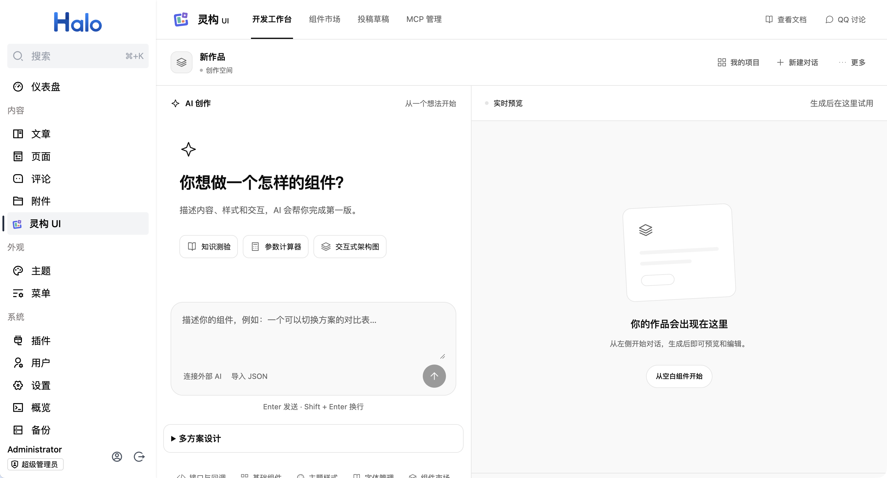
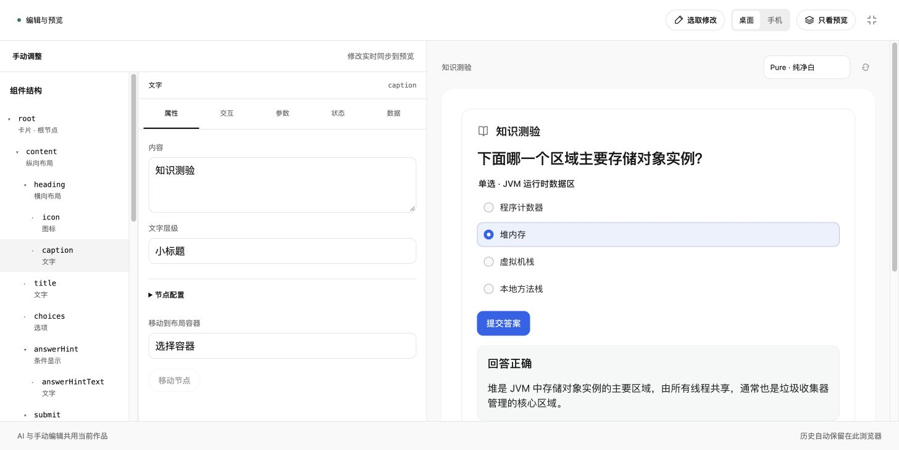
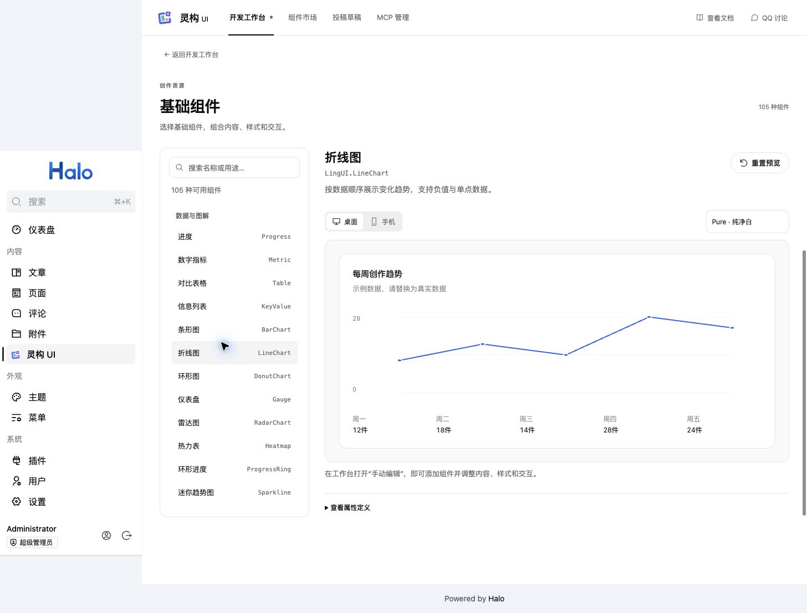
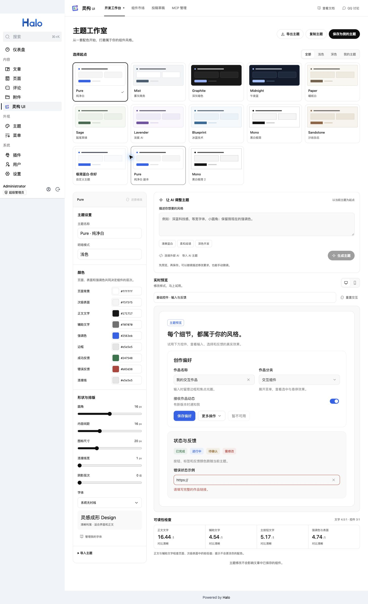
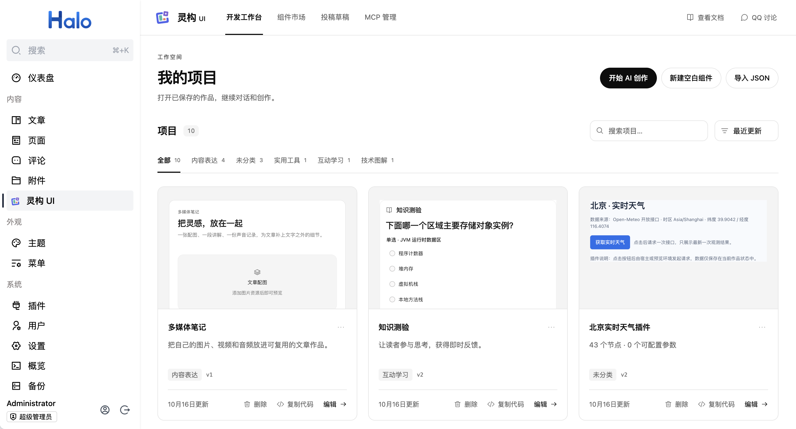
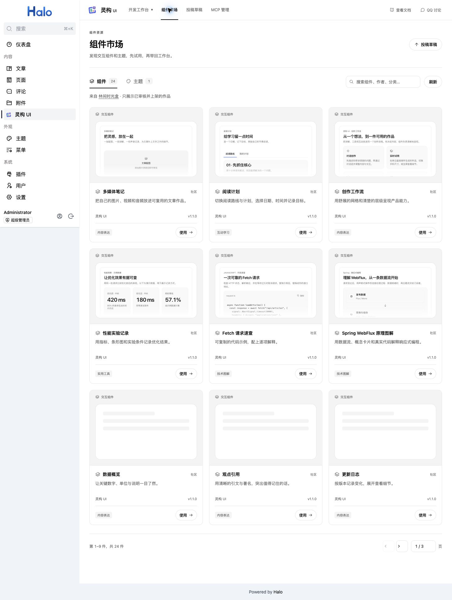

# 灵构 UI

> **Halo 的 AI 交互创作工作台**：用自然语言生成组件，用可视化编辑器细调细节，再把同一个作品放进文章、主题侧边栏或页脚。

灵构 UI 面向 Halo 2.26+，当前提供 **105 种可组合组件**、AI 创作与修改、实时预览、主题与字体管理、API/回调编排、项目版本、组件市场、投稿草稿以及 Skill + MCP 外部 AI 接入。作品采用项目 ID 引用，读者访问页面时按需加载最新保存版本；安装插件不会自动创建项目。

当前插件版本：`1.0.2-rc4`。

## 演示、文档与交流

- **演示站**：[xhhao.com](https://xhhao.com)（林间拾语）
- **在线文档**：[docs.xhhao.com](https://docs.xhhao.com)
- **组件市场**：[auth.lik.cc](https://auth.lik.cc)（林间时光盒，展示已审核作品）
- **QQ 交流群**：[Halo 插件主题交流群](https://qm.qq.com/q/YqlBX8d2Ei)
- **源码**：[github.com/acanyo/plugin-lingui](https://github.com/acanyo/plugin-lingui)
- **问题反馈**：[GitHub Issues](https://github.com/acanyo/plugin-lingui/issues)
- **作者主页**：[Handsome](https://xhhao.com)

## 先看界面

从一个想法开始，在工作台里完成创作、预览和调整。

### AI 对话、实时预览和测验交互

工作台默认进入 AI 对话。输入需求后，右侧预览会显示生成结果；可以选择桌面或手机尺寸、全屏预览、继续对话，或直接进入手动编辑。生成过程会列出查询组件、读取规则和校验设计等实际步骤，失败时显示 HTTP 状态、服务商状态和诊断编号。



已有作品可以直接试用。例如知识测验支持选择答案、显示解析和重新作答；这些交互都在预览中完成，不会修改项目的初始状态。

### 全屏可视化编辑

手动编辑器按组件 ID 展示树结构，属性、交互、参数、状态和数据分别编辑。添加组件、调整父子关系和修改文字会实时同步到预览；全屏编辑适合处理复杂作品。



### 105 种可组合基础组件

组件目录按用途分组并同时显示中文名称和稳定 ID，支持搜索、交互试用和主题切换。组件覆盖布局与容器、内容表达、表单交互、数据图解、媒体、导航与反馈，包含按钮、输入、选择器、表格、图表、架构图、时间线、看板、状态标记等。



### 主题、字体和可读性检查

主题工作室提供 10 套内置主题，也可复制为自己的主题。颜色、圆角、间距、图标尺寸、阴影、明暗模式和字体都能单独调整；AI 主题入口可以按自然语言生成风格建议。字体管理支持导入字体 CSS 链接、CSS 文件或粘贴 CSS，也支持中文分包字体，按需加载字形。



### 项目、市场和外部 AI

项目卡片支持预览、编辑、复制代码、版本和删除。市场把组件和主题分开，作品先试用、下载到我的项目，再插入文章；投稿以项目为来源保存为草稿，等待市场审核。





外部 AI 通过 Halo 官方 MCP Server 接入。灵构 UI 提供组件查询、作品读取、设计校验和草稿提交工具；连接配置、访问密钥和逐工具授权统一在 Halo「工具 → MCP 服务」管理。

## 核心功能

### AI 创作与修改

- 使用 Halo AI Foundation 中配置的模型和凭据；
- 在工作台的 AI 创作区切换生成模型，组件和主题创作共用当前选择，并按 Halo 账号在当前浏览器中记住；清空选择后使用 AI 基座默认语言模型；
- 单方案与多方案共用一个需求输入框，可切换生成方式；多方案结果在对话区比较、重试和采用；
- Skill 负责组件组合、布局、主题和交互规则，MCP 工具按需查询组件参数和作品；
- 生成结果先预览，作者确认后保存，不自动创建项目、不覆盖旧版本；
- 支持继续对话、选取组件局部修改、多方案设计、撤销/重做、版本比较和历史恢复；
- 生成失败时保留当前作品，提供错误详情、诊断编号和重试入口。

### 组件与交互

- 105 种可自由组合的组件，工作台、市场和文章使用一致的展示与交互样式；
- 按组件 ID 定位和编辑，支持属性、状态、参数、数据绑定和主题样式；
- API 请求支持成功、空数据、错误、重试、超时、防抖和并发取消；
- 支持宿主预注册 JS 回调、本地状态联动、自定义事件和交互调试；
- API 测试场景和交互自检只使用显式模拟响应，不执行真实写操作；
- JS 回调需要由站点预先接入，作品配置中请勿填写接口密钥等私密信息。

### 主题与字体

- Pure、Mist、Graphite、Midnight、Paper、Sage、Lavender、Blueprint、Mono、Sandstone 等内置主题；
- 用户指定的风格、颜色和字体优先；
- 主题可复制、重命名、导入、导出和保存为我的主题；
- 字体按 CSS 来源管理，支持字重、斜体和中文分包，浏览器按需加载字形。

### 项目与嵌入

- 项目支持分类、搜索、排序、预览、复制、重命名、删除、导入导出和最多 20 个版本；
- 文章、侧边栏、页脚和主题模板统一使用项目 ID：

  ```html
  <lingui-component data-lingui="component-你的项目ID"></lingui-component>
  ```

- 复制代码时可显式开启公开嵌入；访客不需要登录或 Halo PAT；
- 同页面实例状态相互独立，保存新版本后刷新即可读取最新内容；
- 关闭公开嵌入或删除项目后，文章和主题中引用该项目的位置将无法加载。

### 市场与投稿

- 组件和主题使用独立 Tab，支持搜索、分页、缩略预览和完整交互预览；
- 市场作品先下载到我的项目，再编辑或插入文章，不直接修改文章内容；
- 投稿从我的项目选择，填写作者、版本、许可证和说明，保存为投稿草稿；
- 支持来源署名、许可证、演示录制和审核意见；
- 在工作台中即可浏览市场、下载作品和提交投稿。

### Skill + MCP

安装并启用 [Halo 官方 MCP Server](https://github.com/halo-dev/plugin-mcp-server) 1.3.0 或更高的 1.x 版本后，在 Halo「工具 → MCP 服务」创建访问密钥，并选择灵构 UI 提供的工具。复制官方页面提供的连接配置，将支持 Streamable HTTP 的外部 AI 客户端接入：

- 让 AI 查询可用组件、属性和创作规则；
- 授权作品读取工具后，按项目名称读取已保存项目，继续修改已有作品；
- 校验生成结果，发现缺失参数和无效配置；
- 将草稿提交工具加入密钥后，AI 可把创作结果提交到工作台；
- 在“草稿与操作记录”中查看查询、校验和提交记录，预览草稿及修改内容。

官方 MCP 地址为 `https://你的站点/mcp`，使用官方访问密钥进行 Bearer 认证。密钥按工具授权；新接入的灵构工具需要管理员手动加入密钥。客户端先通过 `tools/list` 发现实际可用的 `plugin-lingui__` 工具，再调用 `plugin-lingui__get_guidance(topic="skill")` 获取创作 Skill，后续参考规则按需读取。

外部 AI 提交的草稿需要你预览、载入和手动保存，不会自动发布项目或执行业务接口。MCP Server 是可选依赖；未安装或停用时，灵构 UI 的工作台、内置 AI 和项目功能仍可使用。

### 从旧版 MCP 迁移

本次为破坏性迁移：灵构 UI 不再提供自建 MCP 服务和专用密钥管理，旧连接地址、灵构专用密钥及按项目授权配置不再生效，也不会自动迁移旧密钥。

1. 安装并启用官方 MCP Server 1.3.0 或更高的 1.x 版本。
2. 超级管理员打开 Halo「工具 → MCP 服务」，创建新的官方访问密钥，按需选择灵构 UI 的查询、读取、校验和草稿提交工具。
3. 用官方页面提供的配置替换 AI 客户端中的旧连接配置，并重新获取工具列表与创作 Skill。

## 快速开始

### 环境要求

- Halo 2.26.0 或更高版本；
- Java 21；
- 安装 AI Foundation 1.x（插件依赖），使用内置 AI 创作前配置服务商和语言模型；
- 外部 MCP 接入另需安装官方 MCP Server `>=1.3.0 & <2.0.0`；
- 字体、图片和外部 API 建议使用支持 HTTPS 和 CORS 的地址。

### 第一个作品

项目列表默认为空，可以自己创作，也可以从组件市场下载作品。

1. 在插件设置中启用 AI 生成，然后在工作台的“生成模型”中选择 AI 基座语言模型，输入具体需求；
2. 等待执行步骤和校验结果完成；
3. 在右侧试用，或点击“手动编辑”调整结构和属性；
4. 选择主题、字体、接口和状态；
5. 点击“保存新版本”；
6. 在项目卡片点击“复制代码”，或在文章编辑器绿色加号中选择“插入灵构 UI”。

已有插件设置中的模型会作为工作台的初始选择。之后在工作台切换模型会用于后续生成；启用开关和输出 Token 预算仍在插件设置中管理。

## 文章和主题中的使用

文章编辑器绿色加号或 Slash 菜单会提供“我的项目 / 应用市场”：市场作品先下载到项目，再确认插入。文章工具栏提供“编辑项目”“刷新预览”“更换组件”和“移除”。主题模板、侧边栏和页脚可直接粘贴项目短标签，前提是主题允许输出原始 HTML。

在“我的项目”卡片点击“复制代码”，按提示开启公开嵌入，再把标签粘贴到主题支持 HTML 的位置。保存项目后刷新页面，文章和主题中的引用会显示最新内容。

更多使用方法见 [在线文档](https://docs.xhhao.com)。

## AI 生成失败排查

工作台会区分认证、权限、模型不存在、限流/额度、参数限制、网络和超时，并显示工作台 HTTP 状态、服务商状态和诊断编号。先展开“查看问题详情”，再检查 Halo 日志；可以缩小需求、切换支持工具调用的模型或重试。失败不会应用半成品，也不会覆盖当前项目。

## 参与贡献

欢迎通过 [Pull Request](https://github.com/acanyo/plugin-lingui/pulls) 贡献问题修复、组件与样式改进、交互优化和文档完善。新功能或较大调整建议先在 [Issues](https://github.com/acanyo/plugin-lingui/issues) 交流想法。

1. Fork 仓库，在自己的分支中完成修改；
2. 提交 PR，说明解决的问题、修改内容和验证结果，相关 Issue 可一并关联；
3. 涉及界面或交互调整时，请附上截图或录屏，方便查看效果。

## 许可证

插件采用 [GPL-3.0](LICENSE)。
